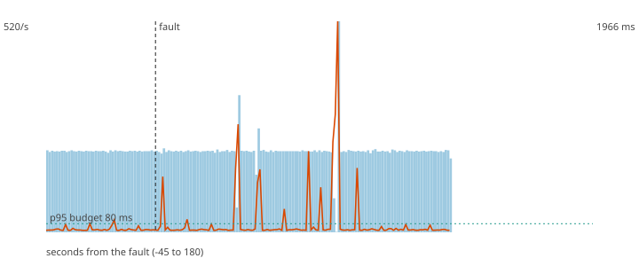

# F0 - Control run, nothing is broken

**Hypothesis (written before the run):** With no fault at all, the same load, warm-up and judging as F8 give no silence over 5 s and a p95 under 80 ms in the window after the "fault" instant. If this fails, the F8 failure is the host (periodic stalls), not the LLM.

**Result: hypothesis CONFIRMED.**

**Mechanism under test:** Nothing is injected; the run measures how much of what the fault experiments report is background noise.

## Method

Steady load of 200 ev/s (about half of the sustained rate) for 60 s, then the fault, then 120 s more. Fault: no fault injected (control run). After the load stopped the decisions topic was drained and every produced `payment_id` was compared with the decisions (`chaos/src/fraud_chaos/verify.py`).

## Numbers

| measure | value |
|---|---|
| payments produced | 84000 |
| lost (produced, never decided) | 0 |
| duplicated decisions (extra copies) | 0 |
| recovery (rate back and p95 back to normal for 5 s; normal = max(80 ms, 1.5 x the pre-fault median p95)) | 4 s |
| longest silence of the decisions topic | 1.0 s |
| p95 before the fault (last 60 s) | 25.4 ms |
| p95 after the fault, judged window | 32.8 ms |
| p95 in the rest of the observation | 219.9 ms |
| degraded decisions after the fault | 0% |
| records added to the DLQ | 0 |

## Checks

- PASS lost 0 (limit 0)
- PASS longest silence 1.0 s (limit 5 s)
- PASS p95 during the fault 32.8 ms (limit 80 ms)

The dashed vertical line is the fault. Bars are decisions per second, the orange line is the p95 of end-to-end latency, the green dotted line is the 80 ms budget.
