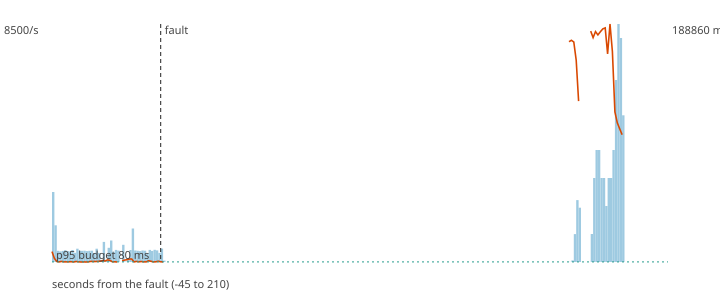

# F1 - The Flink TaskManager dies

> **Why this first run is kept.** The hypothesis was refuted, but not by Flink: Docker does not apply a restart
> policy to a container stopped with `docker kill` (it counts as a manual stop), so nothing brought the TaskManager
> back until the harness cleaned up, 153 s later. The numbers below measure "no orchestrator", not "Flink recovery".
> The injector now plays the orchestrator (starts the container again after 3 s) and the rerun is in `F1.md`.

**Hypothesis (written before the run):** Flink restarts the job from the last checkpoint in under 30 s, loses no payment, and the duplicates it replays are bounded by the checkpoint interval (10 s) times the rate.

**Result: hypothesis REFUTED.**

**Mechanism under test:** Checkpoints every 10 s (RocksDB, incremental) + restart of the job from the checkpoint offsets; the scorer tolerates repeated events.

## Method

Steady load of 400 ev/s (about half of the sustained rate) for 60 s, then the fault, then 150 s more. Fault: SIGKILL to taskmanager; the restart policy brings it back. After the load stopped the decisions topic was drained and every produced `payment_id` was compared with the decisions (`chaos/src/fraud_chaos/verify.py`).

## Numbers

| measure | value |
|---|---|
| payments produced | 84000 |
| lost (produced, never decided) | 0 |
| duplicated decisions (extra copies) | 2530 |
| recovery (rate and p95 inside 80 ms back for 5 s) | never inside the window |
| longest silence of the decisions topic | 153.0 s |
| p95 before the fault | 8238.0 ms |
| degraded decisions after the fault | 0% |
| records added to the DLQ | 0 |

## Checks

- PASS lost 0 (limit 0)
- PASS duplicated 2530 (limit 8000)
- FAIL recovery never (limit 30 s)

The dashed vertical line is the fault. Bars are decisions per second, the orange line is the p95 of end-to-end latency, the green dotted line is the 80 ms budget.
