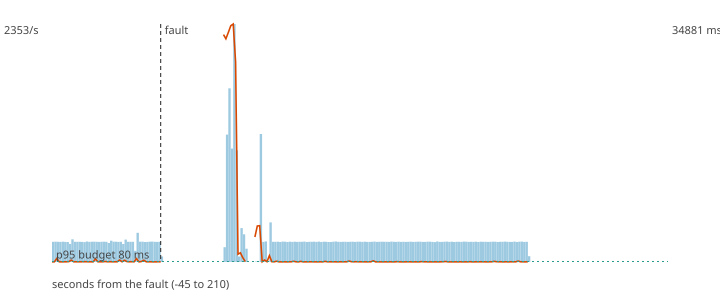

# F1 - The Flink TaskManager dies

**Hypothesis (written before the run):** Flink restarts the job from the last checkpoint in under 30 s, loses no payment, and the duplicates it replays are bounded by the checkpoint interval (10 s) times the rate.

**Result: hypothesis REFUTED.**

**Mechanism under test:** Checkpoints every 10 s (RocksDB, incremental) + restart of the job from the checkpoint offsets; the scorer tolerates repeated events.

## Method

Steady load of 200 ev/s (about half of the sustained rate) for 60 s, then the fault, then 150 s more. Fault: SIGKILL to taskmanager; the orchestrator (this tool) starts it again after 3 s. After the load stopped the decisions topic was drained and every produced `payment_id` was compared with the decisions (`chaos/src/fraud_chaos/verify.py`).

## Numbers

| measure | value |
|---|---|
| payments produced | 42000 |
| lost (produced, never decided) | 0 |
| duplicated decisions (extra copies) | 1424 |
| recovery (rate back and p95 back to normal for 5 s; normal = max(80 ms, 1.5 x the pre-fault median p95)) | 49 s |
| longest silence of the decisions topic | 26.4 s |
| p95 before the fault | 187.5 ms |
| degraded decisions after the fault | 2% |
| records added to the DLQ | 0 |

## Checks

- PASS lost 0 (limit 0)
- PASS duplicated 1424 (limit 4000)
- FAIL recovery 49 s (limit 30 s)

The dashed vertical line is the fault. Bars are decisions per second, the orange line is the p95 of end-to-end latency, the green dotted line is the 80 ms budget.
