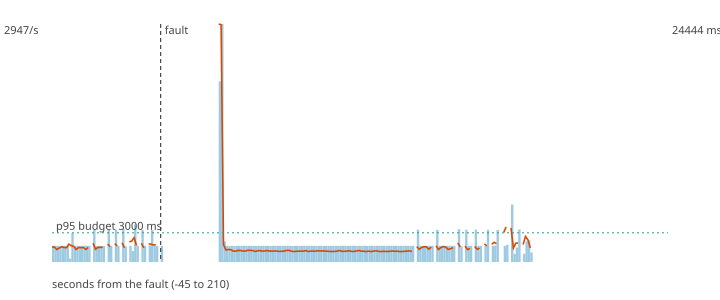

# F10 - The Flink TaskManager dies with exactly-once

**Hypothesis (written before the run):** With a transactional sink (checkpoint every 1 s) and a consumer that reads committed data, killing the TaskManager loses no payment and produces no duplicate decision: Flink aborts the open transaction and replays from the last checkpoint, so the replayed rows are never visible twice. F1 (at-least-once) showed hundreds of duplicates. The price is latency: a row becomes visible only when its checkpoint commits.

**Result: hypothesis CONFIRMED.**

**Mechanism under test:** Kafka sink with delivery-guarantee exactly-once (two-phase commit tied to checkpoints) + isolation.level=read_committed in the scorer.

## Method

Steady load of 200 ev/s (about half of the sustained rate) for 60 s, then the fault, then 150 s more. Fault: SIGKILL to taskmanager; the orchestrator (this tool) starts it again after 3 s. After the load stopped the decisions topic was drained and every produced `payment_id` was compared with the decisions (`chaos/src/fraud_chaos/verify.py`).

## Numbers

| measure | value |
|---|---|
| payments produced | 90000 |
| lost (produced, never decided) | 0 |
| duplicated decisions (extra copies) | 0 |
| recovery (rate back and p95 back to normal for 5 s; normal = max(3000 ms, 1.5 x the pre-fault median p95)) | 26 s |
| longest silence of the decisions topic | 24.1 s |
| p95 before the fault (last 60 s) | 1776.2 ms |
| p95 after the fault, judged window | 17999.8 ms |
| p95 in the rest of the observation | nan ms |
| degraded decisions after the fault | 6% |
| records added to the DLQ | 0 |

## Checks

- PASS lost 0 (limit 0)
- PASS duplicated 0 (limit 0)
- PASS recovery 26 s (limit 90 s)

The dashed vertical line is the fault. Bars are decisions per second, the orange line is the p95 of end-to-end latency, the green dotted line is the 80 ms budget.
