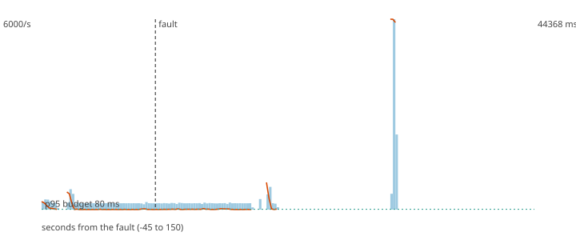

# F2 - One of two scorer processes dies

**Hypothesis (written before the run):** The consumer group rebalances in under 5 s and the survivor takes over the dead process's partitions; nothing is lost and duplicates are bounded by one micro-batch per partition.

**Result: hypothesis CONFIRMED.**

**Mechanism under test:** Consumer group with the cooperative-sticky assignor (incremental rebalance); offsets are committed after each micro-batch.

## Method

Steady load of 200 ev/s (about half of the sustained rate) for 60 s, then the fault, then 90 s more. Fault: 2 scorer processes were running; SIGKILL to 37deac4cec5e. After the load stopped the decisions topic was drained and every produced `payment_id` was compared with the decisions (`chaos/src/fraud_chaos/verify.py`).

## Numbers

| measure | value |
|---|---|
| payments produced | 30000 |
| lost (produced, never decided) | 0 |
| duplicated decisions (extra copies) | 8 |
| recovery (rate back and p95 back to normal for 5 s; normal = max(80 ms, 1.5 x the pre-fault median p95)) | 0 s |
| longest silence of the decisions topic | 45.7 s |
| p95 before the fault | 3288.6 ms |
| degraded decisions after the fault | 0% |
| records added to the DLQ | 0 |

## Checks

- PASS lost 0 (limit 0)
- PASS duplicated 8 (limit 6000)
- PASS recovery 0 s (limit 15 s)

The dashed vertical line is the fault. Bars are decisions per second, the orange line is the p95 of end-to-end latency, the green dotted line is the 80 ms budget.
