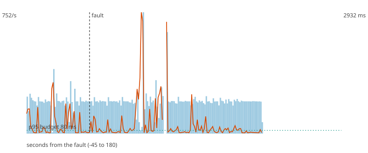

# F3 - Redis is down

**Hypothesis (written before the run):** The scorer does not stop. While Redis is unreachable it decides with neutral profile values and the conservative thresholds, marks the decisions degraded, and nothing is lost.

**Result: hypothesis CONFIRMED.**

**Mechanism under test:** 5 ms Redis timeout in the profile store, ProfileUnavailable handled by the degraded policy (PLAN 7.4).

## Method

Steady load of 200 ev/s (about half of the sustained rate) for 60 s, then the fault, then 120 s more. Fault: redis stopped for 30 s, then started. After the load stopped the decisions topic was drained and every produced `payment_id` was compared with the decisions (`chaos/src/fraud_chaos/verify.py`).

## Numbers

| measure | value |
|---|---|
| payments produced | 36000 |
| lost (produced, never decided) | 0 |
| duplicated decisions (extra copies) | 0 |
| recovery (rate back and p95 back to normal for 5 s; normal = max(80 ms, 1.5 x the pre-fault median p95)) | 2 s |
| longest silence of the decisions topic | 3.1 s |
| p95 before the fault | 33817.3 ms |
| degraded decisions after the fault | 64% |
| records added to the DLQ | 0 |

## Checks

- PASS lost 0 (limit 0)
- PASS longest silence 3.1 s (limit 5 s)
- PASS degraded share 64% (at least 15%)

The dashed vertical line is the fault. Bars are decisions per second, the orange line is the p95 of end-to-end latency, the green dotted line is the 80 ms budget.
