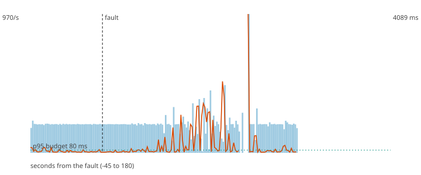

# F4 - Redis answers 20 ms late

**Hypothesis (written before the run):** The 5 ms timeout cuts the slow lookups and the scorer falls back to the degraded policy, so the p95 stays inside the 80 ms budget while Redis is slow.

**Result: hypothesis REFUTED.**

**Mechanism under test:** Socket timeout shorter than the latency budget; the slow dependency costs at most the timeout, never its own latency.

## Method

Steady load of 200 ev/s (about half of the sustained rate) for 60 s, then the fault, then 120 s more. Fault: Toxiproxy latency {'latency': 20} on redis for 60 s. After the load stopped the decisions topic was drained and every produced `payment_id` was compared with the decisions (`chaos/src/fraud_chaos/verify.py`).

## Numbers

| measure | value |
|---|---|
| payments produced | 36000 |
| lost (produced, never decided) | 0 |
| duplicated decisions (extra copies) | 0 |
| recovery (rate back and p95 back to normal for 5 s; normal = max(80 ms, 1.5 x the pre-fault median p95)) | 0 s |
| longest silence of the decisions topic | 4.0 s |
| p95 before the fault | 74.6 ms |
| degraded decisions after the fault | 69% |
| records added to the DLQ | 0 |

## Checks

- PASS lost 0 (limit 0)
- PASS degraded share 69% (at least 20%)
- FAIL p95 after the fault 1074.0 ms (limit 80 ms)

The dashed vertical line is the fault. Bars are decisions per second, the orange line is the p95 of end-to-end latency, the green dotted line is the 80 ms budget.
