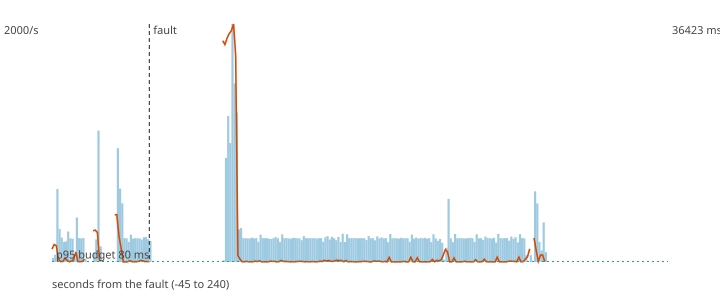

# F5 - The Kafka broker restarts

**Hypothesis (written before the run):** With one broker the pipeline stops while it is down. The generator buffers and retries, the system catches up afterwards, and no payment is lost.

**Result: hypothesis CONFIRMED.**

**Mechanism under test:** Idempotent producer with retries and a producer-side buffer; consumers resume from committed offsets; Flink restarts from its checkpoint.

## Method

Steady load of 200 ev/s (about half of the sustained rate) for 60 s, then the fault, then 180 s more. Fault: kafka stopped for 20 s, then started. After the load stopped the decisions topic was drained and every produced `payment_id` was compared with the decisions (`chaos/src/fraud_chaos/verify.py`).

## Numbers

| measure | value |
|---|---|
| payments produced | 48000 |
| lost (produced, never decided) | 0 |
| duplicated decisions (extra copies) | 0 |
| recovery (rate back and p95 back to normal for 5 s; normal = max(80 ms, 1.5 x the pre-fault median p95)) | 43 s |
| longest silence of the decisions topic | 33.7 s |
| p95 before the fault | 5400.3 ms |
| degraded decisions after the fault | 0% |
| records added to the DLQ | 0 |

## Checks

- PASS lost 0 (limit 0)
- PASS recovery 43 s (limit 120 s)

The dashed vertical line is the fault. Bars are decisions per second, the orange line is the p95 of end-to-end latency, the green dotted line is the 80 ms budget.
