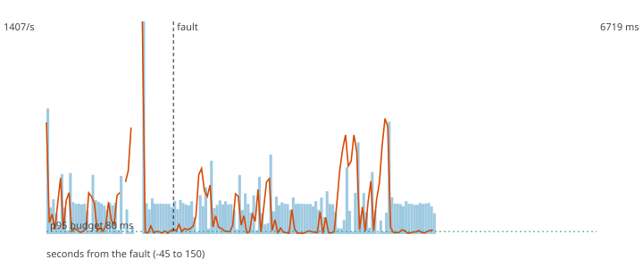

# F6b - Poison pills in the enriched topic

**Hypothesis (written before the run):** Malformed records that reach payments-enriched (past Flink) are routed to the DLQ by the scorer, which keeps scoring: no valid payment is lost and the decision stream has no gap.

**Result: hypothesis CONFIRMED.**

**Mechanism under test:** The scorer validates every enriched event against the contract and publishes the raw bytes of the invalid ones to the dlq topic.

## Method

Steady load of 200 ev/s (about half of the sustained rate) for 60 s, then the fault, then 90 s more. Fault: 500 malformed records written to payments-enriched. After the load stopped the decisions topic was drained and every produced `payment_id` was compared with the decisions (`chaos/src/fraud_chaos/verify.py`).

## Numbers

| measure | value |
|---|---|
| payments produced | 30000 |
| lost (produced, never decided) | 0 |
| duplicated decisions (extra copies) | 0 |
| recovery (rate back and p95 back to normal for 5 s; normal = max(80 ms, 1.5 x the pre-fault median p95)) | 0 s |
| longest silence of the decisions topic | 1.2 s |
| p95 before the fault | 3858.8 ms |
| degraded decisions after the fault | 39% |
| records added to the DLQ | 1000 |

## Checks

- PASS lost 0 (limit 0)
- PASS longest silence 1.2 s (limit 5 s)
- PASS DLQ grew by 1000 (at least 500)

The dashed vertical line is the fault. Bars are decisions per second, the orange line is the p95 of end-to-end latency, the green dotted line is the 80 ms budget.
