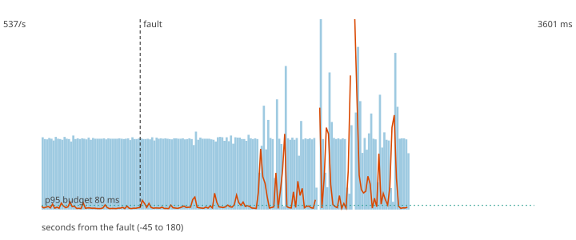

# F7 - MLflow is down and a corrupt model becomes champion

**Hypothesis (written before the run):** The scorer keeps serving the cached model while MLflow is down, refuses the corrupt version when MLflow returns, and the serving version does not change. Decisions never stop.

**Result: hypothesis CONFIRMED.**

**Mechanism under test:** On-disk model cache; the hot swap loads and validates a version before replacing the active one and remembers the rejected ones.

## Method

Steady load of 200 ev/s (about half of the sustained rate) for 60 s, then the fault, then 120 s more. Fault: MLflow down for 30 s; then corrupt version 10 set as champion. After the load stopped the decisions topic was drained and every produced `payment_id` was compared with the decisions (`chaos/src/fraud_chaos/verify.py`).

## Numbers

| measure | value |
|---|---|
| payments produced | 36000 |
| lost (produced, never decided) | 0 |
| duplicated decisions (extra copies) | 0 |
| recovery (rate back and p95 back to normal for 5 s; normal = max(80 ms, 1.5 x the pre-fault median p95)) | 5 s |
| longest silence of the decisions topic | 3.3 s |
| p95 before the fault | 58.4 ms |
| degraded decisions after the fault | 21% |
| records added to the DLQ | 0 |

## Checks

- PASS lost 0 (limit 0)
- PASS longest silence 3.3 s (limit 5 s)
- PASS the serving model version did not change

The dashed vertical line is the fault. Bars are decisions per second, the orange line is the p95 of end-to-end latency, the green dotted line is the 80 ms budget.
