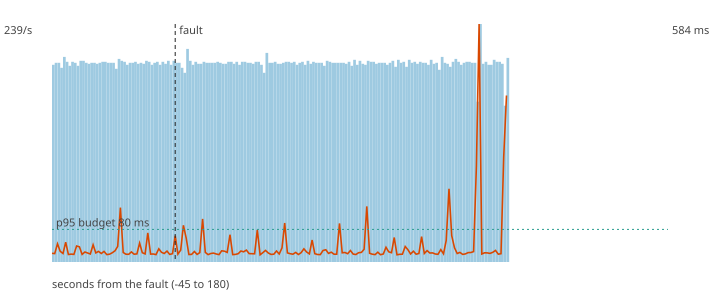

# F8 - The LLM endpoint dies

**Hypothesis (written before the run):** The explainer falls back to the deterministic template, the explanations keep coming, and the critical path does not notice: p95 and loss are unchanged.

**Result: hypothesis CONFIRMED.**

**Mechanism under test:** Circuit breaker around the LLM call plus the template built from the same SHAP facts; the explainer is an independent consumer group.

## Method

Steady load of 200 ev/s (about half of the sustained rate) for 60 s, then the fault, then 120 s more. Fault: SIGKILL to llm-stub; it stays down. After the load stopped the decisions topic was drained and every produced `payment_id` was compared with the decisions (`chaos/src/fraud_chaos/verify.py`).

## Numbers

| measure | value |
|---|---|
| payments produced | 84000 |
| lost (produced, never decided) | 0 |
| duplicated decisions (extra copies) | 0 |
| recovery (rate back and p95 back to normal for 5 s; normal = max(80 ms, 1.5 x the pre-fault median p95)) | 4 s |
| longest silence of the decisions topic | 0.6 s |
| p95 before the fault (last 60 s) | 26.5 ms |
| p95 after the fault, judged window | 33.2 ms |
| p95 in the rest of the observation | 33.7 ms |
| degraded decisions after the fault | 0% |
| records added to the DLQ | 0 |

## Checks

- PASS lost 0 (limit 0)
- PASS longest silence 0.6 s (limit 5 s)
- PASS p95 during the fault 33.2 ms (limit 80 ms)
- PASS explanations by template 100% (at least 80%)

The dashed vertical line is the fault. Bars are decisions per second, the orange line is the p95 of end-to-end latency, the green dotted line is the 80 ms budget.
