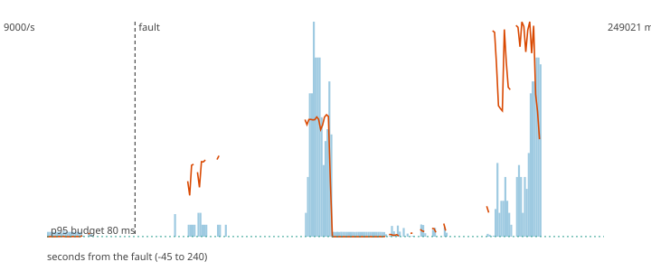

# F9 - Overload burst, twice the steady rate for 60 s

**Hypothesis (written before the run):** The consumer lag grows without any component dying, nothing is lost, and the system returns to its normal latency within two minutes after the burst ends.

**Result: hypothesis CONFIRMED.**

**Mechanism under test:** Kafka as the buffer between stages; no load shedding on payments (PLAN 7.4).

## Method

Steady load of 200 ev/s (about half of the sustained rate) for 60 s, then the fault, then 180 s more. Fault: extra 400 ev/s for 60 s on top of the steady load. After the load stopped the decisions topic was drained and every produced `payment_id` was compared with the decisions (`chaos/src/fraud_chaos/verify.py`).

## Numbers

| measure | value |
|---|---|
| payments produced | 72000 |
| lost (produced, never decided) | 0 |
| duplicated decisions (extra copies) | 98059 |
| recovery (rate back and p95 back to normal for 5 s; normal = max(80 ms, 1.5 x the pre-fault median p95)) | 101 s |
| longest silence of the decisions topic | 40.6 s |
| p95 before the fault | 1939.3 ms |
| degraded decisions after the fault | 24% |
| records added to the DLQ | 604 |

## Checks

- PASS lost 0 (limit 0)
- PASS recovery 101 s (limit 150 s)

The dashed vertical line is the fault. Bars are decisions per second, the orange line is the p95 of end-to-end latency, the green dotted line is the 80 ms budget.
